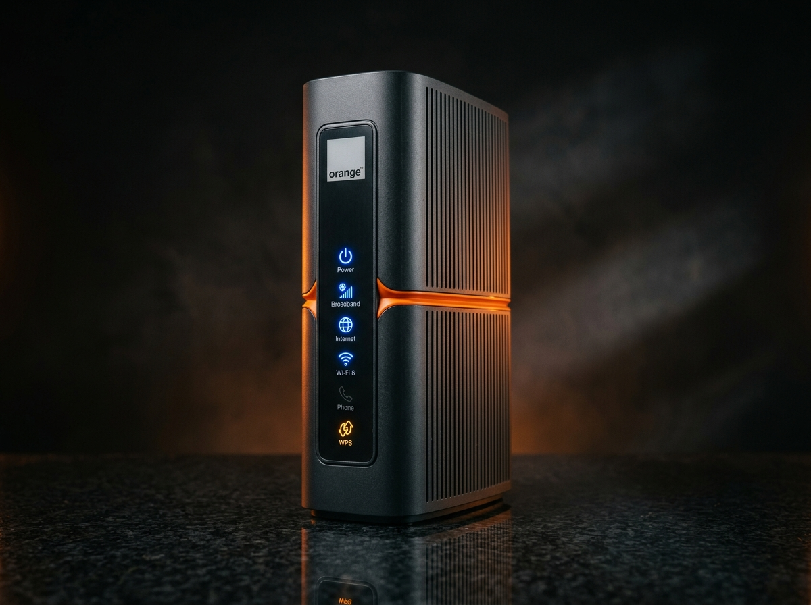

# 🍊 Orange SmartConnect - Digital Self-Care Platform
> **منصة التفعيل الذاتي الذكية لراوترات أورانج مصر**  
> *Official Orange Egypt Router Self-Care & Diagnostic Web Application*



---

## 📋 Overview / نظرة عامة
**Orange SmartConnect** هي منصة ويب تفاعلية متطورة صُممت خصيصاً لمساعدة عملاء الإنترنت المنزلي وموظفي الفروع في تشغيل وضبط راوترات أورانج (VDSL & Wi-Fi 6) وتفعيل خدمة الإنترنت في أقل من 3 دقائق دون الحاجة للاتصال بخدمة العملاء أو الانتظار.

---

## ✨ المميزات الرئيسية (Key Features)

1. **فحص سلامة الخط وكابل السنترال (Physical & DSL Health Checker):**
   - فحص إشارة لمبة الـ DSL ومحاكاة التوصيل السليم عبر السبليتر.
2. **قاعدة بيانات شاملة لراوترات أورانج مصر:**
   - ZTE ZXHN H188A (Wi-Fi 6 High-Speed VDSL).
   - Huawei EchoLife DG8045 (VDSL High-Speed).
   - ZTE ZXHN H168N & H108N.
   - Huawei HG630 V2 & HG532e.
   - TP-Link VN020-F3.
3. **أداة التفعيل السريعة (Magic Bookmarklet):**
   - تعمل على الهاتف (iPhone Safari / Android Chrome) والكمبيوتر بدون أي تحميل.
   - التعرف التلقائي على صفحة الراوتر (192.168.1.1)، كتابة اسم المستخدم الافتراضي (`user` أو `admin`)، تعبئة رقم التليفون الأرضي والباسورد، والضغط على Apply لحفظ الإعدادات تلقائياً.
4. **محاكي شاشات الراوتر التفاعلي (Interactive Router Simulator):**
   - محاكاة شاشة بشاشة مطابقة لواجهات الراوترات الأصلية بنسبة 100%.
5. **مساعد أورانج العائم (Chrome & Edge In-Page Assistant Extension):**
   - إضافة متصفح خفيفة تفتح نافذة المساعد العائم فوق صفحة 192.168.1.1 للبرمجة التلقائية.
6. **أدوات الفحص والتشخيص المتقدمة (Super Diagnostic Tools):**
   - حاسبة كفاءة وجودة الخط الأرضي (SNR Margin & Line Attenuation Calculator) وحساب أقصى سرعة يتحملها الخط وبعد الكابينة بالمتر.
   - مولد كود الاستجابة السريعة (Wi-Fi QR Code) للاتصال بالواي فاي بدون كتابة الباسورد.
   - أداة فحص هوية الأجهزة المتصلة بالماك أدرس (MAC Vendor Identifier).
   - أدوات حماية الأسرة وإعادة تشغيل الراوتر الآمنة بضغطة زر.

---

## 🚀 التشغيل السريع (Local Development)

```bash
# 1. تثبيت الحزم (إن وجدت)
npm install

# 2. تشغيل السيرفر المحلي
npm start
# أو
npm run dev

# السيرفر سيعمل على:
# Local: http://localhost:3000
```

---

## 🌐 النشر على فيرسل (Deploy to Vercel)

المشروع مجهز بالكامل (100% Ready) للنشر الفوري على منصة **Vercel**:

1. ادخل على حسابك في [Vercel](https://vercel.com).
2. اضغط على **Add New Project** ثم اختر مستودع الجيت هاب: `AUTO-CONFIGURE`.
3. اضغط **Deploy** مباشرة (بدون أي إعدادات خاصة أو Build Commands).
4. ستحصل على رابط عالمي مشفر بـ HTTPS في غضون ثوانٍ!

---

## 📁 هيكل المشروع (Project Structure)

```text
orange-smart-connect/
├── api/                        # Vercel Serverless Functions
│   ├── mac-vendor.js           # API: كاشف صانع الجهاز بالماك أدرس
│   └── ping.js                 # API: فحص سرعة الاستجابة
├── assets/                     # الصور والأيقونات الأصلية
├── css/
│   ├── style.css               # التصميم الأساسي ونظام ألوان أورانج
│   ├── components.css          # المكونات والبطاقات وبطاقة البوكماركليت
│   └── simulator.css           # واجهات محاكي الراوتر
├── data/
│   └── mac-vendors.json        # قاعدة بيانات مصنعي الماك أدرس
├── extension/                  # إضافة المتصفح للكمبيوتر ولابتوب الفرع
├── js/
│   ├── app.js                  # وحدة التحكم الرئيسية
│   ├── router-data.js          # بيانات وإعدادات جميع الموديلات
│   ├── simulator.js            # محرك المحاكي التفاعلي
│   ├── script-generator.js     # محرك توليد أكواد البوكماركليت والتفعيل
│   ├── line-calculator.js      # حاسبة كفاءة الخط
│   └── tools-suite.js          # الأدوات الإضافية والـ QR
├── index.html                  # واجهة التطبيق الرئيسية (Single Page Journey)
├── manifest.json               # إعدادات تطبيق الويب التقدمي (PWA)
├── vercel.json                 # إعدادات نشر Vercel و CORS
└── package.json
```

---

## 🔒 الخصوصية والأمان (Privacy & Security)
- التطبيق يعمل بنظام العميل أولاً (Client-Side First).
- لا يتم حفظ أو نقل بيانات وكلمات مرور العملاء لأي خوادم خارجية؛ جميع عمليات التشفير والبرمجة تتم محلياً داخل متصفح المستخدم بأمان تام.

---
**Orange Egypt Digital Care System © 2026**
